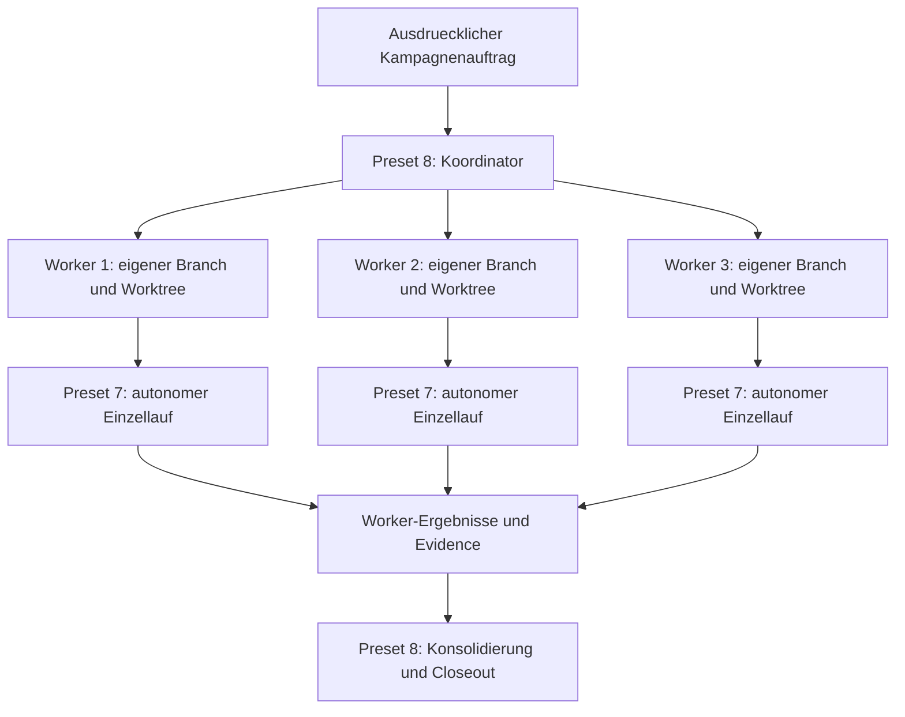

# Parallel Autonomous Run Governance

<!-- current-package: 0.2.9 -->

Paketkennung: **v0.2.9**. [Vorbereitung und Veröffentlichungsgrenze](docs/release-0.2.9-validation.md). Die Release-Seite und der externe Archivnachweis belegen die Veröffentlichung, nicht dieser Vorbereitungsstand. Frühere Versionsnachweise unten bleiben historisch.

<span lang="en">Package identity: v0.2.9. The release page and external archive evidence prove publication, not this preparation snapshot. Earlier version records below remain historical.</span>

[Release-Abschluss und Verbesserungsprofil / Publication closeout and improvement profile](docs/release-0.2.8-validation.md).

Der unten verlinkte Basispaket-Nachweis bleibt historisch; dieses Paket nimmt die Quellenkorrekturen als neue Version auf.

<span lang="en">The linked base-package evidence remains historical; this package includes the source corrections as a new version.</span>

**Leserpfad / Reader path:** [Deutsch: Einstieg, Begriffe und Fehlerhilfe](docs/user-guide.md) · [English: start, terms and troubleshooting](docs/user-guide.EN.md).

Historisches Basispaket **v0.2.8**. Der [Release-Stand](https://github.com/hindermath/spec-kit-preset-parallel-autonomous-run-governance/releases) wird getrennt geprüft; ein Commit auf main ist noch keine Veröffentlichung oder Installation.

*Historical base package v0.2.8. The release page records actual publication separately; a main-branch commit is not publication or installation.*


Patch **0.2.8** liefert die verbesserte zweisprachige Einstiegs- und
Kompositionsdokumentation. Verhalten und Berechtigungsgrenzen bleiben erhalten.
[Release-Nachweis / Release record](docs/release-0.2.8-validation.md).

*Patch 0.2.8 packages the improved bilingual getting-started and composition
guide. Behavior and authority boundaries remain unchanged.*

Permission-bounded coordination for several isolated autonomous Spec Kit runs.

Version `0.2.9` | Priority `80` | Spec Kit `>=0.8.3`

Historical note: version 0.2.6 aligned its installation examples with
Autonomous Run Governance 0.3.6. The current documentation candidate uses
Autonomous 0.4.6 with Parallel 0.2.8, not a newly claimed live field test.
Campaign, authority, and model-routing.json contracts are unchanged.
Required worker preset: `autonomous-run-governance >=0.2.2`

Schema 1.2 optionally binds worker scheduling to a current campaign intake
review. Older schemas and `required: false` retain the prior behavior.

Version 0.2.5 publishes the agent-neutral `model-routing.json` contract for
composition with Model Routing Governance; campaign behavior is unchanged.

Version 0.2.4 requires workers and consolidation to preserve the accepted
project learner and accessibility contract. Runner, provider, and model
defaults cannot weaken audience, language, readability, terminology,
prior-knowledge, or text-first requirements.

## Deutsch

### Vorlagenwahl und Komposition / Template Choice and Composition

Das [Manifest](preset.yml) liefert eigene Kampagnen-Commands und Starter.
Installation erstellt kein Manifest, Worktrees oder Worker. Leite das
Kampagnenmanifest bewusst aus `parallel-campaign-template` ab und validiere
es mit lokalen Runner-Profilen. Ein Starter ist kein gültiger Startauftrag.

*The [manifest](preset.yml) supplies standalone campaign commands/starters.
Installation creates no manifest, worktrees or workers. Deliberately derive
the manifest from parallel-campaign-template and validate it with local
runner profiles. A starter is not a valid execution instruction.*

Beispiel: Zwei unabhängig begründete Features als zwei Worker vorschlagen.
Repositories, Intakes, Abhängigkeiten und Liefermodus deklarieren, `Validate`
prüfen, danach `Start` ausdrücklich genehmigen. Gemeinsame Writer oder
bindende Abhängigkeiten können Parallelität begrenzen. Platzhalter im Beispiel
unten durch freigegebene echte Pfade ersetzen; kein Beispiel ist Feld-Evidence.

*Example: propose two independently justified features as two workers.
Declare repositories, intakes, dependencies and delivery mode, Validate, then
explicitly approve Start. Shared writers/binding dependencies may limit
parallelism. Replace placeholders below with authorized paths; examples are
not field evidence.*

Priorität 80 ersetzt nicht die aktivierte Preset-7-Abhängigkeit jedes Workers.
Kleinere Zahlen haben höhere Auflösungspriorität; andere Presets oder
Projekt-Overrides können gleichnamige Starter ersetzen. Eigene Kombinationen
prüfen. Priorität erteilt weder Scheduling- noch Merge-Autorität. Fehlende
Abhängigkeiten beheben, nicht den Schutzschalter deaktivieren.

*Priority 80 does not replace each worker's enabled Preset 7 dependency.
Lower numbers mean higher precedence; presets/overrides may replace same-name
starters. Check custom combinations. Priority grants neither scheduling nor
merge authority. Resolve missing dependencies instead of disabling protection.*

### Wofuer ist dieses Preset gedacht?

Preset 8 koordiniert mehrere autonome Worker als eine nachvollziehbare
Kampagne. Es stellt Isolation, begrenzte Parallelitaet, dauerhaften Zustand,
Stop/Status/Resume, Handoffs, providerneutrales Rollen-Routing und geordnete
Konsolidierung bereit.

Es fuehrt nicht selbst den Spec-Kit-Einzellauf aus. Jeder reale Worker
verwendet dafuer Preset 7. Installation startet keine Kampagne und erteilt
keine Commit-, Push-, Merge-, Bypass-, Secret- oder Provider-Rechte.

### Abhaengigkeit zu Preset 7



**Textalternative DE:** Preset 8 nimmt einen ausdruecklichen Kampagnenauftrag
an und erstellt fuer jeden Worker einen eigenen Branch und Worktree. Jeder
Worker fuehrt seinen autonomen Einzellauf unter Preset 7 aus. Preset 8 sammelt
nur validierte Worker-Ergebnisse und fuehrt danach die deklarierte
Konsolidierung und den Closeout aus.

**Text alternative EN:** Preset 8 accepts an explicit campaign instruction and
creates one branch and worktree per worker. Each worker executes its autonomous
single run under Preset 7. Preset 8 collects validated worker results and then
performs declared consolidation and closeout.

### Verbindliche Voraussetzung

Fuer regulaere Kampagnen gilt:

- Preset 7 ist in **jedem** Worker-Repository installiert und aktiviert.
- Mindestversion ist `autonomous-run-governance >=0.2.2`.
- Der Standardmanifestwert ist `requireAutonomousPreset: true`.
- Fehlende, deaktivierte oder zu alte Installationen stoppen den Preflight,
  bevor ein Worker startet.
- `requireAutonomousPreset: false` ist nur fuer interne isolierte
  Test-Fixtures vorgesehen und kein unterstuetzter Produktionsmodus.

### In fuenf Minuten vorbereiten

1. Preset 7, danach Preset 8 installieren:

   ```bash
   specify preset add --from https://github.com/hindermath/spec-kit-preset-autonomous-run-governance/archive/refs/tags/v0.4.7.zip --priority 70
   specify preset add --from https://github.com/hindermath/spec-kit-preset-parallel-autonomous-run-governance/archive/refs/tags/v0.2.9.zip --priority 80
   ```

2. Beide Presets pruefen:

   ```bash
   specify preset info autonomous-run-governance
   specify preset info parallel-autonomous-run-governance
   specify preset resolve parallel-campaign-template
   ```

3. Manifest und lokale Runner-Konfiguration aus den Templates ableiten.

4. Kampagne vor jedem Start validieren:

   ```bash
   bash .specify/presets/parallel-autonomous-run-governance/scripts/orchestrate-parallel-autonomous-runs.sh \
     -Action Validate \
     -Manifest specs/NNN-campaign/parallel-campaign.json \
     -RunnerConfig ~/.config/spec-kit/parallel-runner-profiles.json
   ```

5. Erst danach den Start ausdruecklich delegieren.

### Handbuch

| Kapitel | Inhalt |
|---|---|
| [Dokumentationsstart](docs/README.md) | Rollenbasierter Wegweiser |
| [Erste Kampagne](docs/getting-started.md) | Installation, Preflight und sicherer Start |
| [Topologien und Scheduling](docs/topologies-and-scheduling.md) | Vier Topologien, DAG, Handoffs und Parallelitaet |
| [Manifest und Runner](docs/manifest-and-runners.md) | Schema, Profile, Agenten und Isolation |
| [Lebenszyklus und Operationen](docs/lifecycle-and-operations.md) | Status, Stop und Resume |
| [Konsolidierung und Recovery](docs/consolidation-and-recovery.md) | Provider-Gates, Teil-Merge und Fortsetzung |
| [Post-Merge-Closeout](docs/post-merge-closeout.md) | Sync, Aktionen und `Completed` |
| [Fehlersuche](docs/troubleshooting.md) | Blocker und sichere Reaktion |
| [Kompatibilitaet](docs/compatibility.md) | Versionen, Schemas und Upgrade |
| [Feldnachweise](docs/field-evidence/README.md) | Smoke- und 24-Worker-Feldtest |

## English

### What is this preset for?

Preset 8 coordinates several autonomous workers as one auditable campaign. It
provides isolation, bounded concurrency, durable state, stop/status/resume,
handoffs, and ordered consolidation.

It does not execute the single Spec Kit run itself. Every real worker uses
Preset 7 for that lifecycle. Installation starts no campaign and grants no
commit, push, merge, bypass, secret, or provider authority.

### Binding prerequisite

For regular campaigns:

- Preset 7 is installed and enabled in **every** worker repository.
- The minimum is `autonomous-run-governance >=0.2.2`.
- The default manifest sets `requireAutonomousPreset: true`.
- Missing, disabled, or outdated installations fail preflight before any
  worker starts.
- `requireAutonomousPreset: false` is reserved for isolated internal fixtures
  and is not a supported production mode.

### Five-minute preparation

Install Preset 7 at priority `70`, then Preset 8 at priority `80`. Verify both
with `specify preset info`, derive the campaign and local runner files from the
templates, and run coordinator action `Validate` before explicitly delegating
`Start`.

### Manual

| Chapter | Subject |
|---|---|
| [Documentation home](docs/README.md) | Role-based documentation map |
| [First campaign](docs/getting-started.md) | Installation, preflight, and safe start |
| [Topologies and scheduling](docs/topologies-and-scheduling.md) | Four topologies, DAG, handoffs, and concurrency |
| [Manifest and runners](docs/manifest-and-runners.md) | Schema, profiles, agents, and isolation |
| [Lifecycle and operations](docs/lifecycle-and-operations.md) | Status, stop, and resume |
| [Consolidation and recovery](docs/consolidation-and-recovery.md) | Provider gates, partial merge, and continuation |
| [Post-merge closeout](docs/post-merge-closeout.md) | Sync, actions, and `Completed` |
| [Troubleshooting](docs/troubleshooting.md) | Blockers and safe response |
| [Compatibility](docs/compatibility.md) | Versions, schemas, and upgrade |
| [Field evidence](docs/field-evidence/README.md) | Smoke and 24-worker field test |

## Safety summary

- Maximum supported concurrency is three.
- Every worker owns a separate branch and worktree.
- Runner arguments execute as arrays without shell evaluation.
- Fail-closed campaigns require each worker profile to bind its declared stable
  routing role to an explicit local model, reasoning effort, and preflight.
- Status exposes no secrets, environment values, or executable arguments.
- Stop is cooperative and grants no process-kill authority.
- Alternative solutions require named human selection.
- `MergeAndSync` uses an all-ready barrier and resumable checkpoints.
- Child workers publish; only the coordinator performs ordered consolidation.
- `Completed` requires merge, synchronization, post-merge actions, and final
  validation.

## License

MIT
